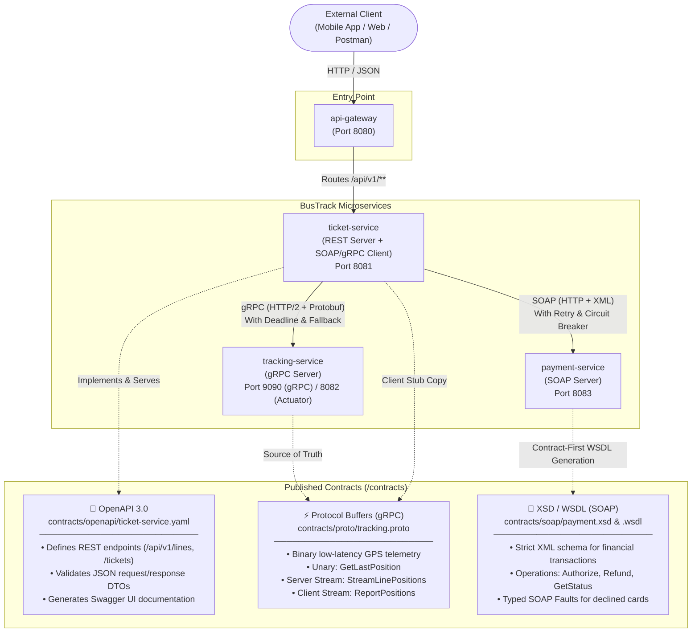

# bustruck
## Microservice Scaffolding (`generation.ps1`)

The `generation.ps1` PowerShell script automates bootstrapping Spring Boot microservices for the **BusTrack** architecture via the [Spring Initializr](https://spring.io) API. Each generated service is configured with Java 17, Maven, and the `com.bustrack.<servicename>` base package.

### Preconfigured Services

| Option | Service Name | Included Dependencies |
| :--- | :--- | :--- |
| **`1`** | `payment-service` | `web-services`, `data-jpa`, `postgresql`, `actuator` |
| **`2`** | `tracking-service` | `data-jpa`, `postgresql`, `actuator` |
| **`3`** | `ticket-service` | `web`, `validation`, `data-jpa`, `postgresql`, `actuator`, `web-services` |
| **`4`** | `api-gateway` | `cloud-gateway`, `actuator` |
| **`A`** | **All Services** | Generates all four core services above in batch |
| **`C`** | **Custom Service** | Prompts for a custom artifact name and comma-separated Spring dependencies |

### Usage

1. Open a PowerShell terminal in the `bustrack/` root directory.
2. *(First-time Windows setup only)* Allow local script execution for your user account:
   ```powershell
   Set-ExecutionPolicy -ExecutionPolicy RemoteSigned -Scope CurrentUser
   ```
3. Run the generator script:
   ```powershell
   .\generation.ps1
   ```
4. Follow the interactive prompt to select one or more services:
   * **Single service:** Enter `1`
   * **Multiple services:** Enter `1,3`
   * **All services:** Enter `A`
   * **New custom service:** Enter `C`

### Post-Generation Notes
* **Protocol Contracts:** After generating the base Spring Boot folders, place your gRPC (`tracking.proto`) and SOAP (`payment.xsd`) contract files into their respective `src/main/` paths or sync them from the `contracts/` directory.
* **Containerization:** Add the service-specific `Dockerfile` to each generated root directory before running `docker-compose up`.


### Contracts (**FlowDiagram**)



