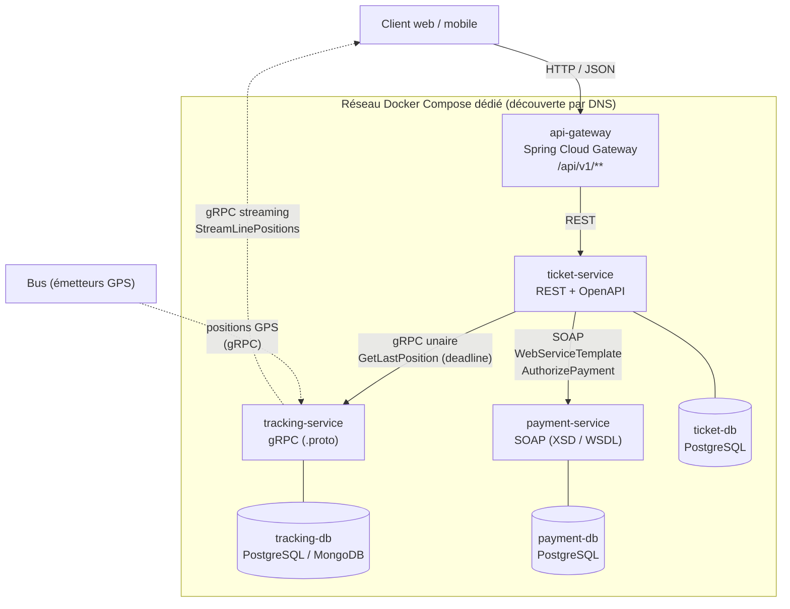

# Fiche sujet : BusTrack, suivi de bus et billetterie

## 1. Problème métier

Une compagnie de transport urbain veut permettre à ses voyageurs de suivre ses bus en temps réel et d'acheter leurs billets depuis une application web ou mobile. Les bus envoient régulièrement leur position GPS, que le système doit traiter et diffuser. L'achat d'un billet nécessite un paiement, délégué à un système bancaire partenaire historique. L'ensemble doit rester disponible même si l'un des services tombe en panne.

## 2. Microservices et responsabilités

| Service | Responsabilité | Ressources métier | Stockage |
|---|---|---|---|
| **api-gateway** | Point d'entrée unique, routage `/api/v1/**`, timeouts | – | – |
| **ticket-service** | Catalogue des lignes et tarifs, achat, consultation et validation des billets, orchestration de l'achat | Ligne, Billet | PostgreSQL (`ticket-db`) |
| **tracking-service** | Réception et diffusion des positions GPS des bus, calcul de la prochaine arrivée | Bus, Position | PostgreSQL ou MongoDB (`tracking-db`) |
| **payment-service** | Autorisation, remboursement et consultation d'un paiement (partenaire bancaire simulé) | Paiement | PostgreSQL (`payment-db`) |

Trois ressources distinctes sont réparties entre les services : Billet, Position/Bus et Paiement.

## 3. Style de chaque service et justification

| Service | Style | Justification |
|---|---|---|
| **ticket-service** | REST | Service exposé aux clients web et mobiles via la gateway. Ressources simples (`/api/v1/tickets`, `/api/v1/lines`), verbes et codes HTTP standards, spécification OpenAPI. |
| **tracking-service** | gRPC | Les bus émettent des positions à haute fréquence et les clients ont besoin d'un flux continu. Contrat `.proto` compact et versionné, adapté à un échange interne performant. |
| **payment-service** | SOAP | Simule une banque ou un système hérité imposé par un partenaire qui n'offre qu'une interface SOAP. Approche contract-first (XSD puis WSDL). |

**Détail des opérations :**

- **gRPC (tracking-service)** :
  - RPC unaire : `GetLastPosition(busId)`
  - RPC en streaming serveur : `StreamLinePositions(lineId)`
- **SOAP (payment-service)** :
  - `AuthorizePayment`, `RefundPayment`, `GetPaymentStatus`
  - SOAP Fault en cas de fonds insuffisants ou de carte invalide

## 4. Flux d'appels inter-services

1. **REST → SOAP** : `POST /api/v1/tickets` déclenche l'appel du `ticket-service` au `payment-service` (`WebServiceTemplate`). Le billet n'est émis que si le paiement est autorisé. En cas d'échec, un repli (Resilience4j) renvoie `503` ou un billet en statut `PENDING`.
2. **REST → gRPC** : `GET /api/v1/lines/{id}/next-bus` fait appeler au `ticket-service` le `tracking-service` en gRPC unaire, avec une deadline, pour obtenir la position et l'heure d'arrivée estimée du prochain bus.

## 5. Schéma d'architecture

**Légende :** les flèches pleines sont les appels synchrones entre composants ; les flèches pointillées représentent les flux de positions (émission des bus et diffusion en streaming).
